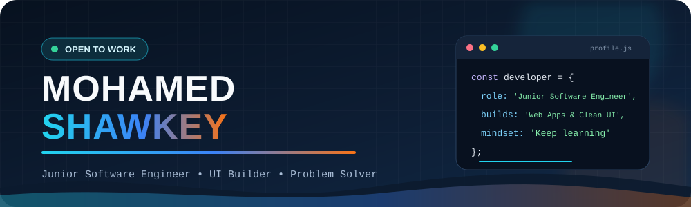
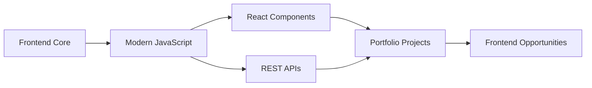

<div align="center">



[](https://www.linkedin.com/in/mohamed-shawkey-166323232)
[](https://www.facebook.com/mohamed.aboamar.5492)
[](https://github.com/Mohamedshawkeyamar)

</div>

## 👨‍💻 About Me

```javascript
const mohamed = {
  role: "Frontend Developer",
  location: "Egypt",
  focus: ["Responsive Interfaces", "Clean UI", "User Experience"],
  currentlyLearning: ["React.js", "Modern JavaScript", "REST APIs"],
  alsoEnjoys: ["Teaching Programming", "Problem Solving"],
  openTo: ["Frontend Roles", "Freelance Projects", "Collaboration"],
};
```

I enjoy turning ideas and designs into practical, responsive web experiences. My current focus is strengthening my React and JavaScript skills while building portfolio-ready projects with clean structure and clear documentation.

## 💼 Experience Focus

| Role | Environment | Main Focus |
|---|---|---|
| Frontend Developer | Project-based work | Responsive websites, interface implementation, and reusable UI |
| Programming Instructor | Coding education | Explaining Python and web fundamentals through practical examples |

## 🧰 Tech Stack

<div align="center">


</div>

| Area | Technologies |
|---|---|
| Frontend Core | HTML5, CSS3, JavaScript |
| UI Development | React.js, Bootstrap, Responsive Design |
| Programming | JavaScript, Python |
| Tools | Git, GitHub, VS Code |

## 🚀 Featured Projects

<table>
  <tr>
    <td width="50%" valign="top">
      <h3>🛒 E-commerce Website</h3>
      <p>A responsive storefront interface focused on clear product presentation, practical layout, and a smooth browsing experience.</p>
      <p><strong>Focus:</strong> HTML, CSS, responsive UI</p>
      <a href="https://github.com/Mohamedshawkeyamar/E-commerce">View Repository →</a>
    </td>
    <td width="50%" valign="top">
      <h3>🌐 Personal Portfolio</h3>
      <p>A personal website created to present my skills, projects, experience, and contact information in a professional way.</p>
      <p><strong>Focus:</strong> Frontend development, UI presentation</p>
      <a href="https://github.com/Mohamedshawkeyamar/portfolio">View Repository →</a>
    </td>
  </tr>
  <tr>
    <td width="50%" valign="top">
      <h3>📰 News Aggregator</h3>
      <p>An application built to collect and organize news content in a simple, accessible structure.</p>
      <p><strong>Focus:</strong> Java, application logic</p>
      <a href="https://github.com/Mohamedshawkeyamar/Newsaggregator">View Repository →</a>
    </td>
    <td width="50%" valign="top">
      <h3>🤖 AI Chatbot — Next Build</h3>
      <p>A lightweight web chatbot planned with a Python backend and a clean browser-based user interface.</p>
      <p><strong>Status:</strong> Planning and development</p>
      <em>Repository coming soon</em>
    </td>
  </tr>
</table>

## 🧭 Current Roadmap



## 📌 What I'm Working On

- Improving my portfolio and project documentation
- Building more complete JavaScript and React projects
- Creating an AI chatbot using Python and web technologies
- Practicing accessible and responsive interface development
- Writing cleaner commits and project READMEs

## 🤝 Open to Opportunities

```text
✓ Frontend Developer roles
✓ Remote and on-site opportunities
✓ Freelance website projects
✓ Collaboration on useful open-source projects
✓ Continuous learning and technical growth
```

## 📬 Let's Connect

If you have an opportunity, project idea, or collaboration in mind, feel free to reach out.

- [LinkedIn — Mohamed Shawkey](https://www.linkedin.com/in/mohamed-shawkey-166323232)
- [Facebook — Mohamed Shawkey](https://www.facebook.com/mohamed.aboamar.5492)
- [GitHub — Mohamedshawkeyamar](https://github.com/Mohamedshawkeyamar)

<div align="center">


</div>
