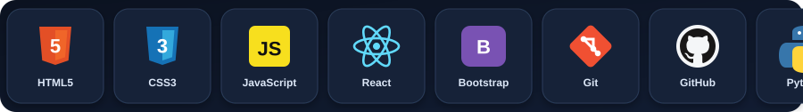
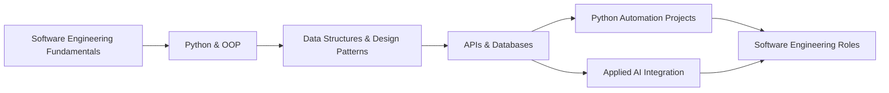

<div align="center">


[](https://www.linkedin.com/in/mohamed-shawkey-166323232)
[](https://www.facebook.com/mohamed.aboamar.5492)
[](https://github.com/Mohamedshawkeyamar)

**Junior Software Engineer | Frontend Developer | Python & AI**

</div>

## 👨‍💻 About Me 

```javascript
const mohamed = {
  name: "Mohmed Shawkey Ketana Ahmed",
  role: "Junior Software Engineer | Frontend Developer",
  location: "Giza, Egypt",
  background: "Computer and Information Technology Graduate",
  focus: ["Software Development", "Web Applications", "API Integration"],
  tech: ["Python", "JavaScript", "Java", "React.js", "SQL"],
  interests: ["Applied AI", "Software Design", "Problem Solving"],
  learningGoals: ["Python Automation", "AI Integration", "Software Architecture"],
  openTo: ["Junior Software Engineer Roles", "Frontend Roles", "Collaboration"],
};
```

I'm a Computer and Information Technology graduate with hands-on experience in web development, REST API integration, and programming instruction. My projects span responsive React interfaces, PHP/MySQL applications, Java networking, and an AI-assisted university learning platform that includes question generation.

I enjoy solving practical problems, learning how software systems work together, and building maintainable applications. I'm expanding my software engineering foundation and exploring **Python automation** and **AI integration** as my next areas of growth.

## 💼 Experience Focus

| Role / Background | Environment | Main Focus |
|---|---|---|
| Software Development | Hands-on software projects | Application logic, databases, APIs, Java and Python fundamentals |
| Freelance Frontend Developer | Project-based work | React interfaces, responsive web applications, and REST API integration |
| Programming Instructor | iSchool and freelance teaching | Python, web development, AI fundamentals, coding exercises, and debugging |
| IT Trainee | Inscription Development · Sep–Dec 2025 | Windows setup, troubleshooting, and foundational IT support |

## 🧰 Tech Stack

<div align="center">



</div>

| Area | Technologies & Concepts |
|---|---|
| Programming | Python, JavaScript (ES6+), Java, PHP, SQL |
| Frontend Development | HTML5, CSS3, React.js, Bootstrap, Tailwind CSS, Responsive Design |
| Backend & Integration | REST APIs, JSON, PHP/MySQL applications, Client–Server Concepts |
| Data & Applied AI | MySQL, Pandas, NumPy, Scikit-learn, AI-Assisted Question Generation |
| Software Engineering | OOP, Data Structures, Algorithms, Design Patterns, Debugging, Multithreading Fundamentals |
| Developer Tools | Git, GitHub, VS Code, PyCharm, Postman, Linux Basics |

## 🚀 Featured Projects

<table>
  <tr>
    <td width="50%" valign="top">
      <h3>🎓 Gateway System</h3>
      <p>A course and training management platform developed for a real organization. I contributed responsive React-based interfaces, backend API integration, and deployment collaboration.</p>
      <p><strong>Focus:</strong> React.js, JavaScript, REST APIs, Web Application Integration</p>
      <a href="https://github.com/Mohamedshawkeyamar/Gateway-System-Showcase">View Public Showcase →</a>
      <p><em>Showcase only; application source code remains private.</em></p>
    </td>
    <td width="50%" valign="top">
      <h3>🧠 University Smart Book System</h3>
      <p>My graduation project (A+): a smart learning platform featuring AI-assisted question generation and interactive educational content. I contributed to interfaces, data processing, and application integration.</p>
      <p><strong>Focus:</strong> React.js, Python, AI-Assisted Features, MySQL</p>
      <em>Academic project</em>
    </td>
  </tr>
  <tr>
    <td width="50%" valign="top">
      <h3>💈 Barber Shop Booking System</h3>
      <p>A booking and queue management application for a barber shop, built around practical reservation workflows and database-backed operations.</p>
      <p><strong>Focus:</strong> PHP, MySQL, Bootstrap, HTML, CSS</p>
      <a href="https://github.com/Mohamedshawkeyamar/barber-shop-booking-system">View Repository →</a>
    </td>
    <td width="50%" valign="top">
      <h3>🎮 Multiplayer Quiz Game</h3>
      <p>A Java quiz application with real-time client–server communication and concurrent player handling using sockets and threads.</p>
      <p><strong>Focus:</strong> Java, Networking, Multithreading, OOP</p>
      <em>Academic project</em>
    </td>
  </tr>
  <tr>
    <td width="50%" valign="top">
      <h3>🛒 E-commerce Website</h3>
      <p>A responsive storefront interface focused on product presentation, practical layouts, and browser-friendly navigation.</p>
      <p><strong>Focus:</strong> HTML, CSS, Responsive UI</p>
      <a href="https://github.com/Mohamedshawkeyamar/E-commerce">View Repository →</a>
    </td>
    <td width="50%" valign="top">
      <h3>🌐 Personal Portfolio</h3>
      <p>A personal website highlighting projects, technologies, experience, and contact information.</p>
      <p><strong>Focus:</strong> HTML, CSS, JavaScript, UI Presentation</p>
      <a href="https://github.com/Mohamedshawkeyamar/portfolio">View Repository →</a>
    </td>
  </tr>
</table>

**Additional project:** [📰 News Aggregator — Java application](https://github.com/Mohamedshawkeyamar/Newsaggregator)

## 🧭 Current Roadmap



## 📌 What I'm Working On

- Strengthening problem-solving, data structures, algorithms, and software design fundamentals.
- Improving existing project code, documentation, and GitHub showcases.
- Building more complete web applications with APIs and databases.
- **Next learning goal:** Create a Python automation project for data processing and reporting.
- **Planned project:** Build a small AI chatbot with a Python backend and a web interface.

## 🤝 Open to Opportunities

```text
✓ Junior Software Engineer roles
✓ Frontend Developer roles
✓ Remote and on-site opportunities
✓ Freelance web development projects
✓ Collaboration on practical software and open-source projects
✓ Continued learning in Python, AI, and automation
```

## 📬 Let's Connect

If you have a software engineering opportunity, a project idea, or a collaboration in mind, feel free to reach out.

- [LinkedIn — Mohamed Shawkey](https://www.linkedin.com/in/mohamed-shawkey-166323232)
- [Facebook — Mohamed Shawkey](https://www.facebook.com/mohamed.aboamar.5492)
- [GitHub — Mohamedshawkeyamar](https://github.com/Mohamedshawkeyamar)

<div align="center">


</div>
